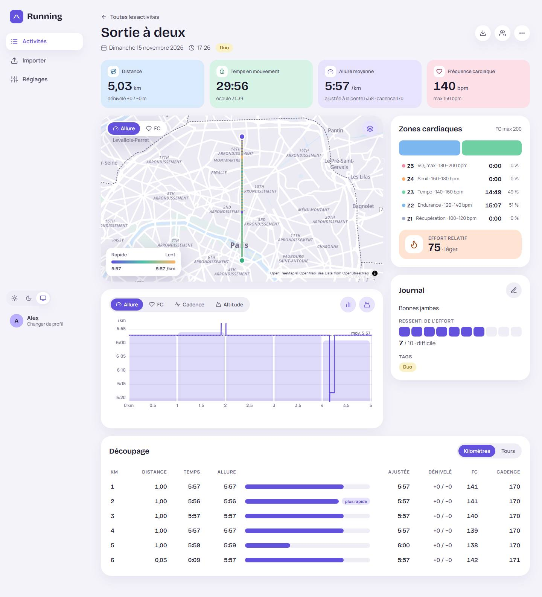
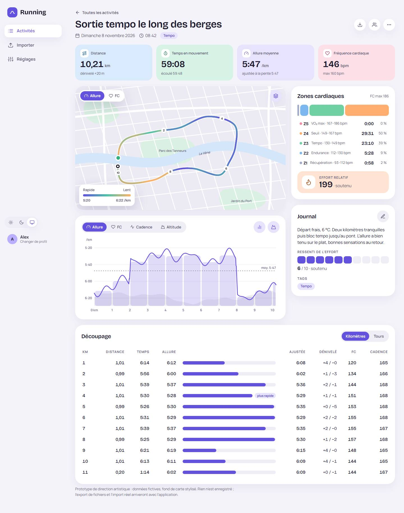

# Design direction

**Status: approved by the owner on 2026-11-15** ("Approved, continue"), on the second iteration of the prototype.

- Prototype source: [`prototype/activity-detail.html`](../prototype/activity-detail.html) (one self-contained page, fictional data).
- Published copy: private Claude artifact "Running — prototype".

The first iteration (single activity page, bordered cards, elevation-first chart) was rejected as too light and too basic. The approved iteration covers the four screens of the web app and follows the owner's stated preferences.

## Principles

1. **Pastel, borderless.** Surfaces are separated by tone and a very soft shadow, never by a border line. No dividers inside cards; rows get a tonal background on hover instead.
2. **One pastel per kind of information.** Lavender = pace, rose = heart rate, mint = time/cadence, sky = distance/elevation, peach = effort, butter = neutral tags. The same pairing is used for tiles, tags, chart series and activity types.
3. **Icons over labels, with tooltips.** Secondary actions are round icon buttons with a tooltip; every icon-only control has an accessible name.
4. **Visible hover states.** Cards lift, rows tint, bars grow; nothing interactive is static under the pointer.
5. **Pace first.** The chart shows pace by default (faster is higher), with the average marked and one block per kilometre. Heart rate, cadence and elevation are one click away; relief is only a faint silhouette.
6. **Responsive by layout change, not shrinking.** Side rail on desktop, bottom tab bar under 900 px; multi-column grids collapse to one column; wide tables scroll inside their card.
7. **Both themes are designed.** Dark is not an inversion: pastels become deep tinted surfaces with light pastel ink.

## Tokens

These are the source of truth for `web/src/lib/tokens.css`.

### Colour — light

| Token | Value | Use |
|---|---|---|
| `--bg` | `#F4F3F9` | page ground |
| `--surface` | `#FFFFFF` | cards |
| `--surface-2` | `#EFEEF7` | tonal fill, hover, inputs |
| `--surface-3` | `#E6E4F2` | stronger tonal fill |
| `--ink` | `#1E1B2E` | text |
| `--ink-2` | `#54506B` | secondary text |
| `--ink-3` | `#6A6682` | tertiary text, axis labels |
| `--accent` | `#6252DE` | primary action, pace series |
| `--accent-soft` | `#E7E3FC` | selected/hover tint |
| `--on-accent` | `#FFFFFF` | text on accent |
| `--p-lav` / `--i-lav` | `#E7E3FC` / `#5446C9` | pastel fill / its ink |
| `--p-mint` / `--i-mint` | `#D6F3E5` / `#1B7550` | |
| `--p-peach` / `--i-peach` | `#FFE4D3` / `#A94F1C` | |
| `--p-sky` / `--i-sky` | `#D8EAFB` / `#1D639F` | |
| `--p-butter` / `--i-butter` | `#FBF1C9` / `#7D6000` | |
| `--p-rose` / `--i-rose` | `#FCDFE7` / `#A82C5A` | |
| `--c-rose` `--c-mint` `--c-sky` `--c-peach` | `#E46F90` `#35AF80` `#4A97D8` `#EE8A4C` | chart series lines |
| `--z1` … `--z5` | `#A3ABC8` `#7DB7F0` `#6FD0A3` `#FFAE70` `#F58AA5` | heart-rate zones |
| `--pace-fast` `--pace-mid` `--pace-slow` | `#6252DE` `#4FC3A8` `#FFB26B` | trace pace ramp |
| `--map-land` `--map-park` `--map-water` `--map-road` `--map-label` | `#ECEBF4` `#D9F0E2` `#D3E6FA` `#FFFFFF` `#6A6682` | basemap |

### Colour — dark

| Token | Value |
|---|---|
| `--bg` / `--surface` / `--surface-2` / `--surface-3` | `#121118` / `#1B1A25` / `#252431` / `#302F3F` |
| `--ink` / `--ink-2` / `--ink-3` | `#F2F0FA` / `#BDB9D1` / `#9F9BB6` |
| `--accent` / `--accent-soft` / `--on-accent` | `#A99BFF` / `#2D2A4B` / `#15122B` |
| `--p-lav` / `--i-lav` | `#2C2949` / `#BDB2FF` |
| `--p-mint` / `--i-mint` | `#1C372E` / `#8FE0BB` |
| `--p-peach` / `--i-peach` | `#3F2D20` / `#FFC39C` |
| `--p-sky` / `--i-sky` | `#1C2F44` / `#9CCBF7` |
| `--p-butter` / `--i-butter` | `#38321A` / `#EFD877` |
| `--p-rose` / `--i-rose` | `#40222E` / `#F7AFC3` |
| `--c-rose` `--c-mint` `--c-sky` `--c-peach` | `#F58AA5` `#6FD0A3` `#7DB7F0` `#FFAE70` |
| `--pace-fast` `--pace-mid` `--pace-slow` | `#A99BFF` `#5FD6BB` `#FFC08A` |
| `--map-land` `--map-park` `--map-water` `--map-road` `--map-label` | `#191822` `#1B2E29` `#1B2A40` `#292836` `#9F9BB6` |

Zone colours are shared by both themes. Profile avatar colours: `#B9AFFF` `#F7AFC3` `#8FE0BB` `#FFC39C` `#9CCBF7` `#EFD877`.

### Type

- Display and numerals: **Bricolage Grotesque** 500/600/700, tabular figures.
- Body: **Manrope** 400–700.
- Scale: h1 36 px (28 px on phone), h2 20 px, tile value 32 px, body 15 px, small 13 px, eyebrow 12 px uppercase with 0.07em tracking.
- In the application the fonts are self-hosted (no request to Google), unlike the prototype.

### Shape and depth

- Radii: 28 px cards, 20 px tiles and inner blocks, 14 px inputs and rows, full pill for buttons, chips and segmented controls.
- Shadow (light only): `0 12px 32px rgba(70,58,140,.07)`; popovers `0 16px 48px rgba(40,30,90,.18)`. Dark theme uses no card shadow.
- Icons: 24-unit stroke icons, 1.9 px stroke, round caps and joins.

### Breakpoints

- 1180 px: two-column page grids become one column.
- 900 px: side rail becomes a bottom tab bar; tiles go from four to two columns.
- 560 px: segmented controls with many options show only the active label.

## Phone and watch (change `android-recording`)

**Status: approved by the owner on 2026-11-15** ("Approuvé, continue"), on the second iteration of the mobile prototype, after reviewing the published copy.

- Prototype source: [`prototype/mobile-recording.html`](../prototype/mobile-recording.html) (one self-contained page, simulated run).
- Published copy: private Claude artifact "Running — prototype mobile".

The first iteration was accepted in principle; the owner asked for a different watch layout, a different default main screen on the phone, and the ability to edit a run's title, effort and note afterwards.

### Decisions

- **Same tokens as the web.** Colours, typefaces, radii and the colour-to-information pairing above apply unchanged on the phone, in both themes. Material dynamic colour is not used.
- **Phone main screen, default fields** (each field stays configurable):
  - top — average pace (lavender) with one bar per kilometre: accent bars for completed kilometres, a lighter bar for the one in progress, pace label above and kilometre number below, eight bars at most;
  - middle left — cadence (mint); middle right — heart rate;
  - bottom — total time and distance beside the mini-map area (sky). The mini-map area draws the trace so far with no basemap; it is the slot a real map will take later.
- **Heart-rate field takes the full zone colour** (`--z1` … `--z5`) with one fixed dark ink in both themes, a "Z*n*" badge and a five-segment zone bar.
- **Controls**: 104 px accent circle for pause/resume, 76 px tonal circles for lap and lock; stop and unlock are hold-to-confirm (about 1.1 s) with a progress ring or fill. The tab bar is hidden during a run.
- **Paused states** dim the fields and show a butter banner; the state pill switches from mint to butter.
- **Watch**: true black, no theme. Time on top (mint), **pace large in the centre** (lavender), distance (sky) and heart rate (zone colour) below; a five-segment zone arc on the rim; two pages (metrics, controls); the app is opened by hand to join the run.
- **Ambient screen on the watch**: keeps the four figures, in a single grey, without the zone arc or the page dots.
- **Editing a run**: a pencil button on the run page opens a bottom sheet with title, effort (1–10 chips, peach when selected) and note.

### Mobile-specific tokens

| Token | Value | Use |
|---|---|---|
| `--zone-ink` | `#1E1B2E` | text on zone colours, both themes |
| live figure, hero | 76 px (with bars) / 92 px, Bricolage Grotesque 600 | top field |
| live figure, half field | 54 px | middle fields |
| live figure, combined field | 44 px | bottom field |
| field label | 13 px, 700, uppercase, 0.04em | all live fields |
| field radius | 28 px | all live fields |
| watch ground / button / primary | `#000000` / `#1F1E29` / `#A99BFF` on `#15122B` | watch |
| watch time / pace / distance | `#8FE0BB` / `#BDB2FF` / `#9CCBF7` | watch metrics |
| watch ambient ink | `#8C8A96` | dimmed screen |
| watch figure sizes | 27 % of the screen width (pace), 11 % (distance, heart rate), 10 % (time) | watch metrics |

### Contrast of the live figures

Spec `mobile-theming` asks for 7:1 between every live-screen figure and its field. Measured with the WCAG 2 formula on the tokens (2026-11-16); `ContrastTest` in `android/core` fails if a token change brings one under 7:1.

| Figure on field | Light | Dark |
|---|---|---|
| ink on lavender (pace, lap time) | 13.4 | 12.2 |
| ink on mint (cadence, time) | 14.2 | 11.4 |
| ink on sky (distance, combined field) | 13.6 | 12.1 |
| ink on butter (clock) | 14.8 | 11.4 |
| ink on rose (heart rate without a reading) | 13.5 | 12.5 |
| ink on surface (lap list) | 16.8 | 15.2 |
| zone ink on Z1 / Z2 / Z3 / Z4 / Z5 (same in both themes) | 7.4 / 7.9 / 9.0 / 9.2 / 7.2 | same |

The pace and kilometre number of the per-kilometre bars are figures too: they use the full ink (13.4 / 12.2 on lavender) instead of the secondary ink, which reached only 6.1 in the light theme. Units and labels keep the secondary ink (6.1–9.0); they are not figures.

On the watch (black ground): time 13.5, pace 11.0, distance 12.3, heart rate in its zone colour 9.1–11.5. The ambient grey reaches 6.2.

**Paused states are dimmed, by decision of the owner (2026-11-16).** The approved design dims the fields to 62 % while the run is paused. Dimmed, the figures fall under 7:1 (4.2–4.9 in the light theme and 5.5–6.5 in the dark one on pastel fields, 2.9–4.3 on a zone colour); this is accepted because the run is not in progress then, and the 7:1 requirement is read as applying to a run in progress.

Abbreviations used on the phone to fit half-width fields: "FC" for heart rate, "ppm" for steps per minute.

## Built page compared with the prototype (task 8.7)

Captured on 2026-11-16 by `web/e2e/design.spec.ts` from the built app (a three-lap test run, default basemap) and from the prototype (its fictional run), in both themes at 360 px and 1440 px. The run differs, so figures and trace differ; layout, colours, type and components are what is compared.

| | Built page | Prototype |
|---|---|---|
| Light, 1440 px | [app-light-1440.jpg](screenshots/app-light-1440.jpg) | [prototype-light-1440.jpg](screenshots/prototype-light-1440.jpg) |
| Dark, 1440 px | [app-dark-1440.jpg](screenshots/app-dark-1440.jpg) | [prototype-dark-1440.jpg](screenshots/prototype-dark-1440.jpg) |
| Light, 360 px | [app-light-360.jpg](screenshots/app-light-360.jpg) | [prototype-light-360.jpg](screenshots/prototype-light-360.jpg) |
| Dark, 360 px | [app-dark-360.jpg](screenshots/app-dark-360.jpg) | [prototype-dark-360.jpg](screenshots/prototype-dark-360.jpg) |

Deviations found and fixed:

- **Basemap palette.** The public style was neutral grey. The default basemap is now recoloured with the `--map-*` tokens when the map loads (land, parks, water, roads, labels), in both themes. A style set through `MAP_STYLE_URL` is left as its author made it.
- **Active tab and active theme button** used the accent colour on the accent-soft fill: 4.44:1 in the light theme. They now use the lavender ink (5.42:1 light, 7.22:1 dark).
- **Tile host out of reach.** The map never finished loading and showed no trace; it now falls back to the plain background.

Contrast: axe's colour-contrast rule (4.5:1, 3:1 for large text) reports nothing on the activity page, the journal being edited, the list, the import screen and the settings, in both themes at both widths. The check is part of the browser test suite.

Known differences, left as they are:

- The prototype numbers every second kilometre on the trace; the built map shows start and finish only (no requirement asks for kilometre markers).
- At 360 px the zone ranges wrap on two lines when both bounds have three digits.
- In full-page captures at 360 px the fixed tab bar appears in the middle of the image; on a phone it stays at the bottom of the screen.

## What the prototype does not decide

- The real basemap style: the prototype's map is a drawn stand-in. The default MapLibre style is recoloured with the `--map-*` tokens (see the comparison above).
- Imperial units, GPX export and real file import are inert in the prototype.
